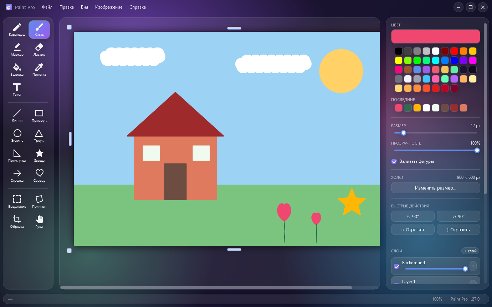
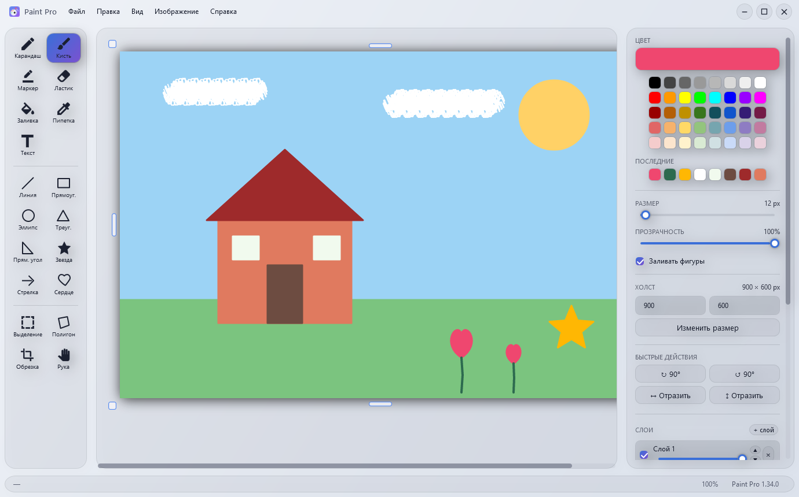
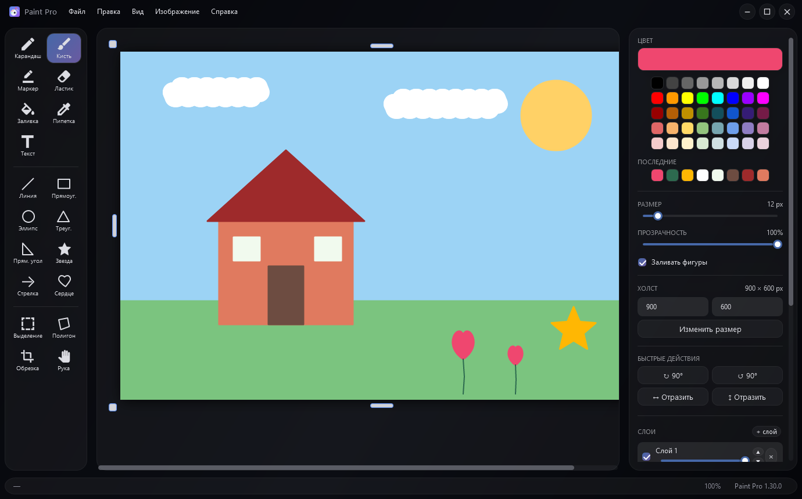

# Paint Pro - WPF + SkiaSharp

[English](CSHARP.md) &nbsp;·&nbsp; [Обе версии: README репозитория](../README.ru.md) &nbsp;·&nbsp; [Скачать](https://github.com/ALEXalesha/PaintPro/releases/latest)

Растровый графический редактор в стиле Apple Liquid Glass (iOS 26 / macOS Tahoe 26).
Перенос Electron-версии на C# 12 + WPF + SkiaSharp.



 

Кадры собирает `tools/PaintPro.Screenshots`: настоящее окно за краем экрана, картинка
рисуется настоящими инструментами через тот же путь, что у мыши, окно снимается само
через `RenderTargetBitmap`. На первых же кадрах нашлись две ошибки (1.27.0): иконки
инструментов, белые в светлой теме, и светло-серые полосы прокрутки на тёмном стекле.

## Что внутри

- `src/PaintPro.Wpf/` - основной WPF-проект
  - `Models/` - `Document`, `Layer`, `Selection`, `FloatingPickup`, `DocumentMode`, `ToolKind`
  - `Commands/` - Command Pattern: `DrawStrokeCommand`, `FillCommand`, `EraseRegionCommand`,
    `RegionDiffCommand`, `ClearCanvasCommand`, `ResizeCanvasCommand`, `PasteCommand`,
    `LayerStackCommand` (добавление / удаление слоя),
    `ReplaceAllLayersCommand` + `DocumentTransform` (поворот / отражение / кадрирование),
    `LayerPropertyCommand` (видимость / прозрачность слоя),
    `LayerTarget` (привязка команды к конкретному слою)
  - `Tools/` - `ITool` + 18 реализаций (Pencil, Brush, Marker, Eraser, Fill, Picker, Text,
    Line, Rect, Ellipse, Triangle, Star, Arrow, Heart, Select, Quad, Crop, Hand)
  - `Services/` - `HistoryManager`, `FileService`, `ClipboardService`, `GeometryMath`,
    `ViewGeometry` (арифметика окна просмотра: размер поверхности под масштаб, перевод
    координат, прокрутка при зуме и панорамировании, положение ручек - вынесена из
    code-behind, чтобы её вообще можно было проверить),
    `BitmapKeying`, `PickupOps` (подъём пикселей, ленивое стирание, сдвиг объекта
    вместе с его маской и попадание мыши в повёрнутый объект), `SkiaBitmapBridge`
  - `ViewModels/` - `MainViewModel`, `ColorEntryViewModel`
  - `Views/` - `CanvasView` (SkiaSharp + overlay), `PromptDialog`. Сборку документа
    (слои + превью инструмента + плавающий объект) держит `Document.Render` - одна и та
    же для экрана и для сохраняемого файла. По ней же выверена `Document.SampleComposite`
    (пипетка и статусбар): всё, что показывает пользователю цвет, обязано брать его из
    одной и той же картинки
  - `Resources/` - `Themes.xaml`, `GlassStyles.xaml`, `ToolIcons.xaml`
- `tests/PaintPro.Tests/` - xUnit, 1144 теста. Каждый файл - разбор одного релиза, и
  каждый тест назван тем, что он защищает, а не тем, что он вызывает. Отдельно стоят два
  фаззера: `TimelineFuzzTests` - случайные последовательности правок по seed'у (двадцать
  пять видов) и четыре инварианта ленты истории поверх них, самый сильный из них «позиция
  курсора однозначно задаёт документ, каким бы путём до неё ни дошли»; и
  `DirtyFlagFuzzTests` - односторонний закон «картинка отличается от сохранённой ⇒
  документ изменён» плюс точечная проверка, что пустой жест документ не пачкает. Пятый
  инвариант ленты - «выключить запись и включить обратно возвращает документ до пикселя». Слой
  представления проверяется настоящими элементами WPF: `WpfRunner` держит один STA-поток
  на всех такие тесты, а `XamlWiringTests` читает `MainWindow.xaml` целиком и проверяет
  каждую привязку, команду и хоткей
- `tools/generate-icon.ps1` - генератор многоразрешённого `.ico` (16/32/48/64/128/256)
- `dist/PaintPro.exe` - финальный self-contained single-file билд (~78 МБ)
- `tools/PaintPro.Screenshots/` - генератор кадров для README (в сборку не входит)
- `paint-pro-electron/` - исходная Electron-версия, живёт параллельно и
  поддерживается. Обе версии лежат в одном репозитории и вместе опубликованы на GitHub
  (<https://github.com/ALEXalesha/PaintPro>). Её устройство и грабли: `paint-pro-electron/docs/ARCHITECTURE.md` и
  `paint-pro-electron/docs/DEV_CONTEXT.md`. Историю обеих версий ведёт общий
  `CHANGELOG.md`; C#-версия - 1.36.1, Electron-версия - 1.21.0. С 1.12.0 версии
  сравнялись по возможностям: в Electron построены слои и выключатель правки в ленте.
  У обеих по пять тем оформления («Вид → Тема»), колесо мыши над холстом меняет размер
  кисти или ластика, сам холст тянется за любую из восьми ручек по краям, а в фигурах
  есть прямоугольный треугольник. С 1.28.0 / 1.16.0 и раскладка одна: инструменты слева с
  подписями, правая панель в одном порядке, обе боковые панели тянутся за край, окно
  помнит размер и место.
  У Electron-версии свои проверки: `paint-pro-electron/tests/` на Playwright, 474 штуки
  (`npm test`), плюс 17 по настоящему приложению - main-процесс, запись файлов и
  клавиатура (`npm run test:app`). Оттуда же собирается один файл для работы в браузере:
  `npm run build:web`.
  Страница открывается в Chromium, мышь водит по холсту по-настоящему, утверждения
  читают пиксели - то же, что xUnit делает для C#-стороны.

## Запуск из исходников

```pwsh
cd src/PaintPro.Wpf
dotnet run -c Release
```

Требует **.NET 8 SDK**. Релизный билд - `dotnet build -c Release`.

## Тесты

```pwsh
dotnet test tests/PaintPro.Tests/PaintPro.Tests.csproj
```

`MainViewModel` в тестах конструируется без диспетчера WPF - через него проверяется весь
слой команд (Undo/Redo/Paste/Delete/смена инструмента), который иначе не покрыт. Не
вызывать оттуда только то, что открывает модальное окно: `NewDocument`/`Open` при
изменённом документе, `ResizeCanvas`, `PickCustomColor` - логику из них выносить в
методы без диалога (так сделаны `MainViewModel.TryParseCanvasSize` и
`MainViewModel.ResetDocument`). Системный буфер обмена из тестов тоже недоступен: он
работает только из STA-потока, а прогон идёт в MTA - то, что не про сам буфер,
проверяется через `ClipboardService.ExtractForClipboard` (он возвращает null, когда
копировать нечего).

## Сборка финального .exe

```pwsh
cd src/PaintPro.Wpf
dotnet publish -c Release -r win-x64 --self-contained true `
  -p:PublishSingleFile=true `
  -p:IncludeNativeLibrariesForSelfExtract=true `
  -p:EnableCompressionInSingleFile=true `
  -o ../../dist
```

На выходе - `dist/PaintPro.exe` (~78 МБ, single file, всё внутри).
Для portable-сборки без runtime: убрать `--self-contained true` → ~5 МБ, но нужен .NET 8 Desktop Runtime.

## Установщик

Inno Setup 6, скрипт - `installer/PaintPro.iss`. Упаковывает готовый
`dist/PaintPro.exe`, поэтому publish должен пройти первым.

```pwsh
& "$env:LOCALAPPDATA\Programs\Inno Setup 6\ISCC.exe" installer\PaintPro.iss
```

На выходе - `dist/PaintPro-Setup-<версия>.exe`. Версия задаётся в двух местах и
должна совпадать: `MyAppVersion` в `.iss` и `<Version>` в `PaintPro.Wpf.csproj`.

Оба каталога `dist/` в `.gitignore` - бинарники не коммитятся.

### Две версии ставятся рядом

C#-версия ставится как **«Paint Pro»** в `%LOCALAPPDATA%\Programs\Paint Pro`,
Electron-версия - как **«Paint Pro Electron»** в `...\Programs\Paint Pro Electron`.
Имена и `appId` у них разные намеренно: до 1.24.0/1.13.0 оба установщика целились в одну
папку и второй затирал первого. В меню «Пуск» два ярлыка с разными именами, удаляются
независимо.

### Иконка

```pwsh
powershell -ExecutionPolicy Bypass -File tools/generate-icon.ps1
```

Перегенерирует `src/PaintPro.Wpf/Assets/AppIcon.ico` (палитра + кисть на градиентном фоне).
csproj уже ссылается на него через `<ApplicationIcon>`.

## Архитектура

См. `REWRITE_PROMPT_CSHARP.md` в корне репозитория для полной спеки и обоснования каждого решения
(включая 7 антипаттернов из Electron-версии и как они адресованы в C#).

### Ключевые инварианты

98 правил, которые держит код, почти у каждого записан баг, из-за которого оно появилось: [INVARIANTS.ru.md](INVARIANTS.ru.md).

### Работа с пикселями напрямую

`SKBitmap.GetPixel`/`SetPixel` пересекают managed/native границу на каждый вызов.
Для попиксельных проходов это доминирующая стоимость: заливка холста 900×600 через
них занимала около 700 мс. `FillCommand` вместо этого копирует сырой BGRA-буфер
через `Marshal.Copy`, работает с `byte[]` и копирует обратно - те же 900×600
укладываются в 25 мс, 4000×3000 в 172 мс.

Буфер премультиплицированный (`Bgra8888`/`Premul`), поэтому цвет заливки нужно
премультиплицировать вручную: `SetPixel` делал это за нас. После записи в нативную
память обязателен `NotifyPixelsChanged()`, иначе Skia может отдать закешированное.

### Форматы файлов

Skia умеет **кодировать только PNG / JPEG / WebP** - `SKImage.Encode` для BMP и GIF
возвращает `null`. Поэтому диалог «Сохранить как» предлагает только эти три, а если
целью оказался другой контейнер (например, открыли `.gif` и нажали Ctrl+S), файл
пишется рядом как `.png` с предупреждением. Открывать при этом можно всё, что
Skia декодирует, включая BMP и GIF.

Запись идёт через `File.Create`, а не `File.OpenWrite`: второй не обрезает файл, и
меньшая картинка поверх большей оставляла бы хвост предыдущей.

### Добавить новый tool

1. Реализовать `ITool` в `Tools/MyTool.cs`.
2. Добавить значение в `ToolKind` enum и, если это фигура, вписать его в
   `IsShapeTool`/`IsDrawingTool` - списки там сквозные, и `ToolSizeWheelTests` требует,
   чтобы перечисление было покрыто целиком.
3. Зарегистрировать в `MainViewModel._tools`.
4. Добавить `Geometry` в `Resources/ToolIcons.xaml` и `ToggleButton` в `MainWindow.xaml`
   (левая панель) + опционально `KeyBinding`.

Всё. Никаких изменений в Document, History, или CanvasView не требуется. Электронная
версия ведётся тем же шагом: кнопка с `data-tool`, имя в `toolNames`, значение в
`SHAPE_TOOLS` и ветка в `drawShape`.

### Выделения

- **Select (S)** - растянуть прямоугольник, клик внутри поднимает пиксели в
  `FloatingPickup`, дальше 8 ручек масштаба и ручка поворота.
- **Quad (Q)** - то же для четырёхугольника. Углы помечены точками и тянутся по
  отдельности: это меняет форму клипа, содержимое не деформируется. Клик внутри
  полигона поднимает пиксели, дальше пикап двигается, масштабируется и вращается
  как прямоугольный. Перетаскивание угла намеренно **не** запускает ленивое
  стирание - исходные пиксели остаются на месте, пока пикап не сдвинут.
- Переход между **S** и **Q** объект не прижимает: это две руки для одного и того же,
  и «выдели прямоугольником - искриви углы» работает как один жест. Прижимает его
  переход на любой другой инструмент, «снять выделение» (Ctrl+D) и Enter; Escape
  возвращает пиксели на место.
- Зона хвата угловой точки ограничена половиной меньшей стороны выделения: на мелких
  фигурах середина остаётся телу, иначе четыре угла накрывали бы её целиком.
- **Shift** у угловой ручки держит пропорции, у ручки поворота ставит угол на ровные 15°.
  Боковые ручки меняют одну сторону по определению - Shift их не касается.
- Ctrl+C по поднятому объекту кладёт в буфер его самого, на прозрачном фоне; Ctrl+C по
  рамке - то, что видно внутри неё, сборкой всех слоёв. Если копировать нечего (объект
  или рамка целиком за холстом), Ctrl+C отказывает и говорит об этом, а Ctrl+X при этом
  ничего не вырезает.
- Растянутый или повёрнутый объект прижимается со сглаживанием, один к одному - без:
  фотографию не хочется получать лесенкой, а пиксельный рисунок - размытым.
- Слой, с которого объект подняли, помнится по идентификатору. Его можно удалить, пока
  объект в руках: прижмётся он тогда в активный слой, а вернуть исходные пиксели уже
  нечем - их забрало удаление слоя, и возвращает их его отмена.
- Белый фон вычитается при подъёме прямоугольника с нижнего слоя (`BitmapKeying`),
  чтобы выделение не тащило за собой непрозрачный белый прямоугольник. У
  многоугольника форму задаёт его маска, а на верхних слоях фон и так прозрачный -
  там вычитать нечего, и попытка выкусывала бы нарисованное белым.

Флажок **«Заливать фигуры»** в правой панели переключает прямоугольник, эллипс,
треугольник, прямоугольный треугольник, звезду и сердце между контуром и заливкой.

## Хоткеи

| Действие | Клавиши |
|---|---|
| Pencil / Brush / Marker / Eraser | P / B / M / E |
| Fill / Picker / Text | G / I / T |
| Line / Rect / Ellipse | L / R / O (по месту клавиши, на любой раскладке) |
| Select / Quad / Crop / Hand | S / Q / C / H |
| Undo / Redo | Ctrl+Z / Ctrl+Y / Ctrl+Shift+Z |
| New / Open / Save / Save As | Ctrl+N / Ctrl+O / Ctrl+S / Ctrl+Shift+S |
| Cut / Copy / Paste | Ctrl+X / Ctrl+C / Ctrl+V |
| Select All / Deselect (прижимает поднятое) | Ctrl+A / Ctrl+D |
| Delete / Cancel / Commit | Delete / Esc / Enter |
| Повернуть поднятое выделение | [ / ] (∓90°), Shift+[ / Shift+] (∓15°) |
| Масштаб поднятого с сохранением пропорций | Shift + угловая ручка |
| Поворот поднятого шагом 15° | Shift + ручка поворота |
| Zoom in / out / reset | Ctrl+= / Ctrl+- / Ctrl+0 |
| Zoom через колесо | Ctrl + wheel |
| Drag & drop файла | открывает изображение (заменяет документ) |

## Технологии

- **WPF** (.NET 8.0-windows) - нативный UI, blur/acrylic, hardware-accelerated
- **SkiaSharp 2.88** + **SkiaSharp.Views.WPF** - рендеринг канваса (Chrome's Skia)
- **CommunityToolkit.Mvvm 8.3** - `[ObservableProperty]`/`[RelayCommand]` source generators
- **WPF-UI 3.0** - для acrylic glass-эффектов
